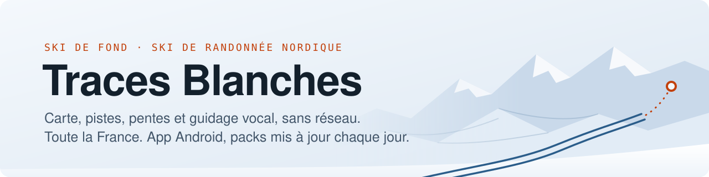

<picture>
  <source media="(prefers-color-scheme: dark)" srcset="banner-dark.svg">
  
</picture>

  <a href="https://tracesblanches.github.io"><b>Site</b></a> ·
  <a href="https://tracesblanches.github.io/fr/demarrage.html">Démarrage</a> ·
  <a href="https://tracesblanches.github.io/fr/faq.html">FAQ</a> ·
  <a href="https://tracesblanches.github.io/fr/licences.html">Données et licences</a> ·
  <a href="https://github.com/tracesblanches/tracesblanches/issues">Issues</a> ·
  <a href="https://tracesblanches.github.io/">English</a>

  
  
  
  

En forêt du Haut-Doubs ou au fond d'une vallée du Queyras, le réseau tombe. Le plan des pistes est une image, le bulletin d'avalanche est sur un autre site, et vos doigts sont dans des gants.

Traces blanches réunit sur le téléphone ce qu'il faut pour une journée de ski de fond ou de ski de randonnée nordique en France, et le garde disponible sans réseau. Vous préparez la journée le matin. Ensuite, le téléphone reste dans la poche et une voix vous guide.

| | Dépôt | Contenu |
|---|---|---|
| 🎿 | [**tracesblanches**](https://github.com/tracesblanches/tracesblanches) | Le noyau en Rust : chaîne de données, routage, temps estimés, voix. Ensuite l'app Android en Kotlin (prévue). |
| 🌐 | [**tracesblanches.github.io**](https://github.com/tracesblanches/tracesblanches.github.io) | Le site. |
| 📋 | [**.github**](https://github.com/tracesblanches/.github) | Ce profil, les règles de contribution et les modèles d'issues. |

#### Ce que contient un pack hors ligne

Un pack couvre un site. La chaîne de données le construit ; le téléphone le lit sans connexion. La construction quotidienne sur un serveur est prévue.

- **Deux fonds de carte** : Plan IGN v2 et OpenStreetMap, en tuiles vectorielles.
- **Les pistes de fond** d'OpenStreetMap : nom, difficulté, classique ou skating, sens.
- **Les pentes de plus de 30°**, calculées sur le relief LiDAR HD de l'IGN au pas de 5 m.
- **L'exposition aux avalanches**, modélisée sur le relief et la forêt (méthodes AutoATES v3.0 et Flow-Py, portées en Rust). La comparaison avec les avalanches connues est en cours.
- **Les zones protégées** et leurs règles par période, les **refuges** (refuges.info), les **zones sans aucun réseau**, 112 compris (cartes ARCEP).
- **La neige estimée** à partir de la simulation nivologique de Météo-France, le **bulletin d'avalanche** du massif avec sa date.
- **Les clips de la voix** : noms des pistes, des refuges et des lieux, générés à l'avance.

#### Où en est le projet

- **Fait** : le noyau et la chaîne de données, en Rust, évalués sur deux sites réels, Cervières (Hautes-Alpes) et Chapelle-des-Bois (Doubs). Routage sur pistes, temps estimé, heure de demi-tour avant la nuit, routage hors piste, règles des zones à une position et une date.
- **Prévu** : l'app Android (carte, journée planifiée, guidage vocal écran éteint, utilisable avec des gants), puis iOS.
- **Prix envisagé** : un paiement unique, sans abonnement ni publicité. Le code reste libre.

#### Contribuer

Les contributions sont bienvenues, y compris celles écrites avec un outil d'IA. Chaque contribution arrive avec ses tests et ses preuves, et son auteur en répond. Lisez [CONTRIBUTING.md](https://github.com/tracesblanches/.github/blob/main/CONTRIBUTING.md) avant d'ouvrir une demande de fusion.

#### Sécurité en montagne

Traces blanches ne dit jamais qu'une pente est sûre. L'app montre l'âge et la source de chaque information. Elle ne remplace ni le bulletin d'avalanche, ni votre jugement sur le terrain.

Offline map, trails, slopes and voice guidance for cross-country and Nordic backcountry skiing in France. Rust core today; Android app planned. Code under GPL-3.0-or-later with an app store exception. <a href="https://tracesblanches.github.io/">English page</a>.
